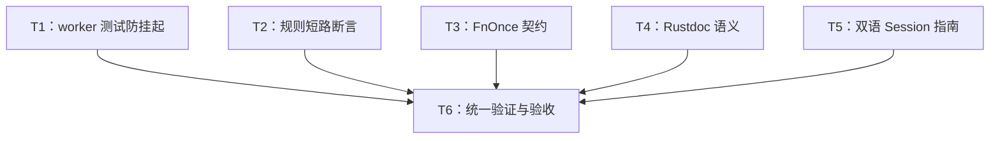

# rs-retry 本轮评审改进实施计划

> **面向智能体执行者：** 使用 executing-plans 逐项执行；如实施阶段选择并行执行，可使用 subagent-driven-development，按下表分配互不相交的写入集合。各步骤使用复选框跟踪进度。下一阶段的实施命令决定具体操作授权。

**目标：** 完成本轮全部 5 项已采纳意见，增强测试对回归的检测能力并纠正文档。

**架构：** 保持现有生产架构、公共 API 和运行语义。通过测试专用 watchdog、契约断言和局部文档修正实现目标；无需下游迁移。

**技术栈：** Rust 2024、Rust 1.94、std 线程/channel/Instant/原子变量、Cargo、现有 Python 文档检查器。

**工作位置：** `/data/working/qubit/rust-common/rs-retry`，沿用当前 Paseo workspace；计划与设计使用用户指定的 doc 路径，不设临时文档工作区。

**设计依据：** [设计文档](design-20261029T045051006Z-70c8a050.md)。评审基线 `7f2e165d00ffbee21387717c9fb5d68173ae45ed`，实施前重新核对。

## 采纳范围与持续约束

| 评审编号 | 内容 | 任务 |
| --- | --- | --- |
| RSRETRY-001 | worker 测试独立防挂起机制，P2 | T1 |
| RSRETRY-002 | 正常规则短路的调用次数断言，P3 | T2 |
| RSRETRY-003 | 真正 FnOnce 映射器测试，P3 | T3 |
| RSRETRY-004 | 三处 Rustdoc 语义修正，P3 | T4 |
| RSRETRY-005 | 双语 Session 状态约束与取消入口，P3 | T5 |

本次未限定采纳子集，依用户规则纳入全部五项。**明确搁置或拒绝的条目及原因：无。** 不纳入评审过程中筛除的其他候选。

持续约束与设计一致：

1. 在当前 Paseo workspace 内处理目标目录与相关下游，不创建或打开新的 Paseo workspace。
2. 仅修改本任务直接相关的内容，不顺手重构、格式化或清理。格式化和最终 diff 审查也需保持此边界。
3. CI 只验证当前 crate，不加入或保留 downstream all-features 测试。

不改公共 API、生产逻辑、依赖或版本；生产源码的变更仅为 T4 注释。没有删除、移动、重命名既有文件的任务。提交、推送或分支操作不是本计划自行授予的权限，按未来实施命令及届时有效会话授权执行，不将方案生成阶段边界延续为实施禁令。

## 调度图

T1—T5 的文件互不重叠，均属并行批次 A；没有需要先提交的接口产物。可串行执行，但不应虚构前置依赖。所有 Cargo/CI/文档构建使用同一资源组 C，避免同时争用 target/cache；代码编辑可并行，重型验证串行调度。全量验证仅由 T6 负责。

| 任务 | 前置任务 | 最小解锁产物 | 写入集合（仓库相对路径） | 本地验证 | 集成验证归属 | 审查时机 |
| --- | --- | --- | --- | --- | --- | --- |
| T1 | 无；批次 A | 已有 worker API | `tests/support/worker_watchdog.rs`（新建）、`tests/support/mod.rs`、`tests/executor/worker_retry_tests.rs`、`tests/executor/worker_contract_tests.rs` | worker 两模块测试及一次故障注入校准；资源 C | T6 | helper 边界立即审查 |
| T2 | 无；批次 A | 已有 RetryRule API | `tests/rule/rule_order_contract_tests.rs` | 单个契约测试；资源 C | T6 | 批量审查 |
| T3 | 无；批次 A | 已有两个 map_error API | `tests/error/attempt_failure_tests.rs`、`tests/error/retry_error_tests.rs` | 两模块测试；资源 C | T6 | 批量审查 |
| T4 | 无；批次 A | 现有源码事实 | `src/rule/internal/retry_rules.rs`、`src/executor/attempt_cancellation_token.rs`、`src/observer/internal/retry_observers.rs` | 注释 diff 和链接静态核对 | T6 严格 Rustdoc | 批量审查 |
| T5 | 无；批次 A | 现有 Session API | `doc/user_guide.md`、`doc/user_guide.zh_CN.md` | 双语事实和示例注解核对 | T6 示例编译执行 | 批量审查 |
| T6 | T1、T2、T3、T4、T5 | 五项改动与局部证据齐全 | 仅处理上述任务确有必要的修正；其他文件保持范围边界 | 统一格式、diff、现有 CI 和补充缺项；资源 C | T6 | 立即集成审查 |

## 任务拓扑依赖图



## T1：worker 测试的两层保护

**文件与接口：** 按调度表。新增仅测试可见的 `run_worker_test<T, F>(test: F) -> T` 和 `wait_for_cancellation(token: &AttemptCancellationToken, watchdog_fired: &AtomicBool)`。不对生产 crate 导出，不引入依赖。`tests/support/mod.rs` 的模块声明和 re-export 均受 `#[cfg(feature = "worker")]` 保护。

- [ ] 阅读相关测试和 `tests/support/mod.rs`，确认基线及已有 helper 命名无冲突。读取适用 Rust 测试/注释规则；本阶段只写计划的限制不适用于此后的已授权实施。
- [ ] 新建 `tests/support/worker_watchdog.rs`，沿用项目七行许可证头。采用如下最小实现，导入按单对象及项目分组规则放置：

```rust
use std::panic::AssertUnwindSafe;
use std::panic::catch_unwind;
use std::panic::resume_unwind;
use std::sync::atomic::AtomicBool;
use std::sync::atomic::Ordering;
use std::sync::mpsc;
use std::thread;
use std::time::Duration;
use std::time::Instant;

use qubit_retry::AttemptCancellationToken;

/// Bounds a worker test independently of the injected retry clock.
pub(crate) fn run_worker_test<T, F>(test: F) -> T
where
    T: Send + 'static,
    F: FnOnce() -> T + Send + 'static,
{
    let deadline = Instant::now() + Duration::from_secs(10);
    let (sender, receiver) = mpsc::channel();
    let handle = thread::spawn(move || {
        let result = catch_unwind(AssertUnwindSafe(test));
        let _ = sender.send(result);
    });
    let result = receiver
        .recv_timeout(deadline.saturating_duration_since(Instant::now()))
        .expect("worker test exceeded its real-time limit or lost its runner");
    while !handle.is_finished() {
        assert!(Instant::now() < deadline, "worker test runner did not exit");
        thread::yield_now();
    }
    handle.join().expect("worker test runner panicked outside its test body");
    match result {
        Ok(value) => value,
        Err(payload) => resume_unwind(payload),
    }
}

/// Releases a stuck test operation without relying on timer cancellation.
pub(crate) fn wait_for_cancellation(
    token: &AttemptCancellationToken,
    watchdog_fired: &AtomicBool,
) {
    let deadline = Instant::now() + Duration::from_secs(5);
    while !token.is_cancelled() {
        if Instant::now() >= deadline {
            watchdog_fired.store(true, Ordering::SeqCst);
            return;
        }
        thread::yield_now();
    }
}
```

- [ ] 在 `tests/support/mod.rs` 添加 worker 门控的模块和两个 re-export。这是唯一共享写入点，T1 独占。

```rust
#[cfg(feature = "worker")]
mod worker_watchdog;
#[cfg(feature = "worker")]
pub(crate) use worker_watchdog::run_worker_test;
#[cfg(feature = "worker")]
pub(crate) use worker_watchdog::wait_for_cancellation;
```

- [ ] 将以下五个用例的原有主体整体移入传给 `run_worker_test` 的无捕获闭包，再调用该 helper；函数外层仅保留这次调用。保留主体内全部初始化、断言和返回类型，不另写替代用例：
  - `test_worker_retry_matches_shared_infrastructure_and_timeout_matrix`，仅替换其中 timeout 分支的取消循环。
  - `test_worker_timeout_uses_injected_timer`。
  - `test_worker_timeout_poll_failure_reaps_operation`。
  - `test_worker_attempt_timeout_has_a_distinct_terminal_reason`。
  - `test_worker_shorter_flow_timeout_reports_flow_source`。
- [ ] 每个目标循环用以下模式替换；matrix 每个 timeout 分支单独创建 flag。正常终态必须同时满足原有断言和 `watchdog_fired == false`。按文件增加 `AtomicBool` 与 helper import。

```rust
let watchdog_fired = Arc::new(AtomicBool::new(false));
let worker_watchdog_fired = Arc::clone(&watchdog_fired);
// 在原有 worker 闭包中替换原来的 while 循环：
wait_for_cancellation(&token, &worker_watchdog_fired);
// 保留原有 worker 返回值及终态断言；控制线程最后追加：
assert!(!watchdog_fired.load(Ordering::SeqCst), "worker cancellation watchdog fired");
```

- [ ] `test_worker_timeout_uses_injected_timer` 保留 started channel、deadline 确认和手动时钟推进。将现有 `handle.join()` 替换为同一个 10 秒真实 deadline 内的 `is_finished()` 有界轮询，再 join；现有“未注册 deadline 时请求取消”的清理分支保留。外层 `run_worker_test` 仍是最终保护，不让内层 join 绕过它。
- [ ] 局部验证（在仓库根目录）：

```bash
cargo test --test tests --no-default-features --features worker executor::worker_retry_tests::
cargo test --test tests --no-default-features --features worker executor::worker_contract_tests::
```

预期：均退出 0，测试确实被发现且运行；正常路径不触发 watchdog，原有原因、次数和手动耗时不变。

- [ ] 校准失败路径：临时仅在 `test_worker_timeout_uses_injected_timer` 的等待 helper 处改用独立新建、永不取消的 `AttemptCancellationToken`，并将该临时用例 grace 改为 6 秒，使 5 秒 watchdog 先触发。运行下列命令，预期非零退出且在 10 秒保护窗口附近有界结束，日志显示 watchdog/终态断言失败。不得以放宽断言让校准通过。

```bash
cargo test --test tests --no-default-features --features worker test_worker_timeout_uses_injected_timer -- --nocapture
```

- [ ] 还原这两处临时故障注入，仅保留计划加固；检查 diff 后重跑同一命令，预期退出 0。校准产生的实际耗时、线程退出情况一并记录。无需为了“红绿”修改生产 timer 或 worker 协议。

**审查要点：** watchdog 使用标准 Instant；flag 必须从外层检查；捕获断言 panic 后必须重新传播；超时路径不做无界 join；正常线程退出与测试失败时可能仍有后台线程的情况如实区分。若实际运行发现新生产缺陷，记录证据后判断范围，不能静默扩张修复。

## T2：验证后续规则完全不执行

**文件：** `tests/rule/rule_order_contract_tests.rs`。前置无，接口保持不变，集成归 T6。

- [ ] 在文件顶部导入 `Arc`、`AtomicUsize`、`Ordering`，将已有局部 `AbortRule` 改为携带计数器，保留第一条 `RetryOnly`：

```rust
struct AbortRule(Arc<AtomicUsize>);
impl RetryRule<UnitTestError> for AbortRule {
    fn decide(&self, _: &AttemptFailure<UnitTestError>, _: &RetryContext) -> RetryDecision {
        self.0.fetch_add(1, Ordering::SeqCst);
        RetryDecision::Abort
    }
}
```

- [ ] 构建原有配置时使用新的计数对象，替换原 `.rule(AbortRule)`；终态检查后增加零调用断言。

```rust
let later_calls = Arc::new(AtomicUsize::new(0));
// 原 builder 的第二条规则替换为：
// .rule(AbortRule(Arc::clone(&later_calls)))
// 原有终态和 last_failure 断言后追加：
assert_eq!(later_calls.load(Ordering::SeqCst), 0);
```

- [ ] 在同一个测试最后用独立配置把计数规则放在第一条，调用一次；保留原配置的结果不受影响。校准完整内容：

```rust
let calibration = RetryConfig::<UnitTestError>::builder()
    .rule(AbortRule(Arc::clone(&later_calls)))
    .build()
    .expect("valid calibration config");
let calibration_error = Retry::new(&calibration)
    .run::<(), _>(|| Err(UnitTestError))
    .expect_err("the first abort rule stops the flow");
assert!(matches!(calibration_error.reason(), RetryErrorReason::Aborted));
assert_eq!(later_calls.load(Ordering::SeqCst), 1);
```

- [ ] 运行 `cargo test --test tests --no-default-features rule::rule_order_contract_tests::`，预期退出 0。该增强在当前正确实现上直接通过是预期结果；不伪造已有功能失败，也不为制造失败修改生产规则。

## T3：让两个映射器真正只实现 FnOnce

**文件：** `tests/error/attempt_failure_tests.rs`、`tests/error/retry_error_tests.rs`。前置无，接口保持不变，集成归 T6。

- [ ] 在两个现有映射闭包中使用相同的最小改动：

```rust
move |NonCloneError(mut error)| {
    error.push_str(&suffix);
    drop(suffix);
    error
}
```

- [ ] 保留原有结果断言。第一文件继续检查非 Clone 原错误被消费及 timeout/panic 不调用 mapper；第二文件继续检查 reason、context、原错误内容与 completion diagnostics。
- [ ] 运行以下命令，预期退出 0。编译成功直接证明当前 API 接受这种只能调用一次的闭包。

```bash
cargo test --test tests --no-default-features error::attempt_failure_tests::
cargo test --test tests --no-default-features error::retry_error_tests::
```

- [ ] 审查实际闭包确实移动消费 `suffix`，不能仅添加 `move`。无需 compile-fail 框架，不修改生产 trait bound，不要求通过故意改坏生产签名获取失败日志。

## T4：修正三处 Rustdoc 事实

**文件：** 调度表所列三个生产文件。仅注释变更，前置无，严格文档验证归 T6。

- [ ] `RetryRules::clone` 的返回说明替换为：

```rust
/// A collection sharing the same immutable ordered rule slice and callback
/// objects through reference counting; no rule vector or operation error is
/// cloned.
```

- [ ] `AttemptCancellationToken` 的取消说明替换为：

```rust
/// During [`WorkerRetry::run`](crate::WorkerRetry::run), the executor marks
/// this token as cancelled when it requests the current worker to stop, such
/// as after a timeout or flow cancellation. The worker must check
/// [`AttemptCancellationToken::is_cancelled`] and return on its own; the
/// executor cannot safely kill Rust threads.
```

- [ ] `notify_terminal_failure` 的参数项替换为：

```rust
/// - `reason`: Frozen terminal reason, distinct from any retained attempt
///   failure; terminal notification can also occur before the first attempt.
```

- [ ] 逐处对照字段、签名及实际运行入口，检查注释之外没有 token 变化；不进行顺手属性整理。将严格 Rustdoc 的执行合并到 T6。

## T5：补齐中英文 Session 指南

**文件：** `doc/user_guide.md`、`doc/user_guide.zh_CN.md` 的 Session 章节。前置无，编译执行归 T6。

- [ ] 保留原有完整示例和注解，新增 `RetryCancellationToken`、`RetryErrorReason` 的公共 import。在现有 Session 创建处改为以下绑定，两种语言代码语义相同：

```rust
let cancellation = RetryCancellationToken::new();
let mut session = RetrySession::new(config, clock.new_timer())
    .with_cancellation_token(cancellation.clone());
```

- [ ] 在原有成功值断言后，仍处于同一个 `main` 中补充预取消入口；现有 config 已移入 Session，必须新建配置，不能错误复用已移动变量。

```rust
cancellation.cancel();
let cancelled_config = RetryConfig::<&str>::builder()
    .build()
    .expect("valid cancelled-session config");
let mut cancelled_session = RetrySession::new(cancelled_config, clock.new_timer())
    .with_cancellation_token(cancellation);
let error = cancelled_session.begin_attempt().expect_err("pre-cancelled session stops");
assert!(matches!(error.reason(), RetryErrorReason::Cancelled { .. }));
assert_eq!(error.context().attempts(), 0);
```

- [ ] 示例后补充以下英文操作契约，Rustdoc 链接可以直接指向当前版本的 `RetrySession::begin_attempt` 和 `record_result`：

> Only execute an operation after Admitted, and report exactly one result for that admission. Waiting does not admit an operation. Calling begin_attempt while an operation is active, recording a result without a matching admission, or calling either method after termination is a programming error and panics. Stop driving the session after Complete, Failed, or an admission error. Configure session cancellation with with_cancellation_token. Cancellation is checked at admission and failure boundaries; it does not interrupt an admitted operation or wake your external scheduler. The scheduler must observe the token and drive the session again when appropriate.

- [ ] 中文独立表达同样事实：只有准入后才能执行且只登记一次结果；Waiting 不产生操作；重复、无准入及终态后调用属于会 panic 的状态误用；终止后停止驱动；取消入口是 `with_cancellation_token`；外部调度器负责唤醒和驱动，取消不会强行打断已准入操作。
- [ ] 静态核对两个示例的 import、所有权、注解及新增输出断言；示例仍可作为完整二进制编译，不添加未标注的独立 Rust 片段。T6 统一运行现有 checker 验证两种语言。

## T6：统一验证与验收

**前置：** T1—T5 完成，所有编辑者释放文件。统一负责所有昂贵检查，不派 worker 重复运行全量命令。

- [ ] 核对最终 diff 与五项范围映射。新增文档本身及 T1 测试 helper 属于预期文件；不得处理其他目录、README 或 CI 配置的顺手修改。
- [ ] 按届时有效项目规则进行相关格式整理。若使用 `./.infra/bin/align-ci.sh`，先检查其影响范围，保存已有改动基线；出现非任务文件变更时逐项处理，不能覆盖用户工作。检查 `git diff --check`；格式改变的相关文件需复核。
- [ ] 在仓库根目录运行 `./.infra/bin/ci-check.sh`，记录命令、退出码及阶段日志。本仓库配置含 style、clippy、verify、strict-doc、feature-matrix、project-hook、coverage 等检查；读取实际执行输出核对，不能只依据配置认定已覆盖。
- [ ] 将实际日志与以下验收矩阵核对；**只对没有在本次 CI 门禁中执行的项目补运行对应命令**。不因任务拆分重复全量测试或 coverage。

| 验收项目 | 日志缺少该项时的补充命令 | 预期 |
| --- | --- | --- |
| 默认特性下当前 crate 测试 | `cargo test --no-default-features` | 退出 0，目标用例按 feature 可见性发现 |
| 当前 crate 全特性测试 | `cargo test --all-features` | 退出 0，含 worker/async/tokio/serde 组合 |
| 严格公开 Rustdoc | `RUSTDOCFLAGS="-D warnings" cargo doc --all-features --no-deps` | 退出 0，无失效链接或文档告警 |
| 当前 crate 全目标 Clippy | `cargo clippy --all-targets --all-features -- -D warnings` | 退出 0 |
| 双语示例 | `python3 -B scripts/check_doc_examples.py --fetch` | 全部标注示例编译执行成功，包含修改后的两个 Session 示例 |

CI local hook 已会执行 checker 回归及文档示例；成功日志齐全时无需再次运行。依赖已缓存时可使用 checker 默认离线模式；冷缓存使用表中 `--fetch`。这不是增加 downstream all-features 测试，也不要求修改 CI。

- [ ] 任何失败先定位是否由本轮改动引起；修正对应任务后，只重跑受影响验证及必要集成检查。依赖网络等外部故障应记录为未完成验证，不声称通过，不扩张任务修复外部工程。
- [ ] 核对五项完成证据：T1 正常通过与故障校准失败、线程保护无无界 join；T2 后续规则 0 次且校准规则 1 次；T3 两个一次性闭包编译及原诊断断言通过；T4 注释事实与链接正确；T5 双语契约及示例一致。
- [ ] 再检查 `git diff --check`、`git status --short`、最终差异，记录实际变更文件与检查退出码。输出未完成项、限制或风险；没有证据的检查不得写“已通过”。是否提交及推送遵循实施命令，不把其执行与否当作本计划自授要求。

## 交付自检记录（方案阶段）

- 调度表、拓扑图和任务正文均为 T1—T6，同一组 ID；所有评审项均有对应任务。
- T1—T5 互不争用文件，T6 汇总验证；没有人为要求先提交接口的依赖。
- 未提出 API 或依赖变更、下游迁移、额外风格重构、删除/移动文件。
- 文档列出实施命令与预期结果，仅为下一阶段安排；方案生成阶段没有执行代码修改、编译、测试或 CI，也不预先声称验证通过。
